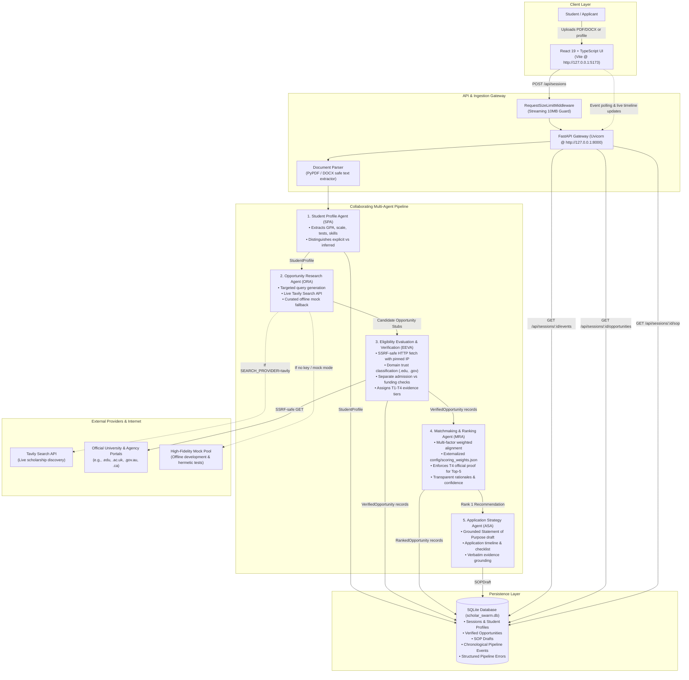

# ScholarSwarm AI — System Architecture

This document describes the end-to-end multi-agent architecture, data contracts, security defenses, and execution flow of ScholarSwarm AI.

---

## 1. End-to-End System Architecture Diagram

---

## 2. Core Agent Pipelines & Data Contracts

### 1. Student Profile Agent (SPA)
- **Input:** Raw multipart file bytes (`resume_file`, `transcript_file`) or direct structured JSON payload.
- **Processing:** Extracts academic attributes using deterministic pattern engines:
  - CGPA extraction with mandatory scale binding (`4.0`, `10.0`, `100%`). Rejects arbitrary cross-scale interpolation.
  - Standardized test score boundary validation (IELTS: 0.0–9.0, TOEFL: 0–120, GRE: 260–340).
  - Explicit skills (from dedicated skills sections) versus inferred skills (from narrative experience) with confidence tagging.
- **Output:** Validated `StudentProfile` Pydantic model stored in the `sessions` table.

### 2. Opportunity Research Agent (ORA)
- **Input:** Validated `StudentProfile`.
- **Query Synthesis:** Generates targeted queries combining target degree, preferred destination countries, and extracted academic interests (e.g., `"fully funded masters scholarships in Canada Computer Science"`).
- **Search Execution:**
  - When `SEARCH_PROVIDER=tavily` and `SEARCH_API_KEY` is set: executes live queries against `https://api.tavily.com/search`.
  - When offline or unconfigured: seamlessly queries `MOCK_SCHOLARSHIP_POOL`.
- **Deduplication:** Normalizes URLs by lowercasing hostname and path, stripping query parameters, and eliminating fragment identifiers.
- **Output:** List of candidate dictionaries tagged with `verification_tier="T1"`, `source_type="unknown"`, `is_mock=True/False`, and `search_provider`.

### 3. Eligibility Evaluation & Evidence Verification Agent (EEVA)
- **SSRF Defense:** External URLs are inspected through `safe_fetch_url()` in `backend/app/utils/ssrf.py`:
  - Resolves domain to IP addresses and rejects all private, loopback, link-local, multicast, and cloud metadata addresses (e.g., `169.254.169.254`).
  - Pins the socket connection directly to the pre-validated IP to eliminate Time-of-Check to Time-of-Use (TOCTOU) DNS rebinding attacks.
  - Enforces strict redirect caps (maximum 3 hops) with re-validation at each hop.
- **Domain Trust Classification:**
  - `OFFICIAL_PROVIDER`: Verified academic institutions and government scholarship agencies (`.edu`, `.ac.uk`, `.gov`, `.gc.ca`, `.edu.au`, `.daad.de`, etc.).
  - `RELIABLE_SECONDARY`: Established cultural or bilateral organizations (DAAD, Campus France, Fulbright, Chevening).
  - `AGGREGATOR`: Third-party listings (ScholarshipPortal, WeMakeScholars).
  - `UNKNOWN`: Unclassified personal blogs or unverified domains.
- **Independent Eligibility Evaluation:** Separately computes `admission_eligible` and `scholarship_eligible`.
- **Tier Assignment:**
  - `T4`: Official provider domain + HTTP 200 accessible + verbatim grounded evidence excerpt.
  - `T3`: Official or reliable secondary domain without verbatim excerpt.
  - `T2`: Accessible non-official web sources.
  - `T1`: Inaccessible or mock fallback.
- **Output:** `VerifiedOpportunity` records classified into `confirmed_eligible`, `potentially_eligible`, `ineligible`, or `expired`.

### 4. Matchmaking & Ranking Agent (MRA)
- **Scoring Engine:** Deterministically scores candidates using 5 weighted dimensions (`config/scoring_weights.json`):
  $$\text{Score} = 0.30 \times \text{Field} + 0.25 \times \text{Funding} + 0.20 \times \text{Deadline} + 0.15 \times \text{Eligibility} + 0.10 \times \text{Completeness}$$
- **Top-5 Strict Constraint:** Only opportunities achieving **T4 verification from official providers** qualify for Top-5 recommendations (`rank` = 1..5). Lower-tier items receive `rank = None` and appear in "Other Opportunities".
- **Output:** `RankedOpportunity` records with explainable rationales and confidence metrics (`high`, `medium`, `low`).

### 5. Application Strategy Agent (ASA)
- **Input:** Highest-ranked recommendation and student profile.
- **Synthesis:** Produces a structured Statement of Purpose (SOP) draft:
  - Academic grounding and core research interests.
  - Specific institutional alignment based on verified evidence.
  - Actionable checklist with verified deadlines, missing documentation prompts, and revision suggestions.
- **Output:** `SOPDraft` persisted to SQLite and served to the UI.

---

## 3. Failure Handling & Mock Distinctions

| Scenario | System Behavior | Data Integrity Guarantee |
|---|---|---|
| **No API Key / Network Disconnect** | ORA gracefully falls back to `MOCK_SCHOLARSHIP_POOL` | Every record receives `is_mock=True`, `provider="mock"`, and `tier="T1"`. No mock record can ever achieve Top-5 status. |
| **Search Engine Error (500 / 401)** | ORA catches exceptions and falls back to mock | Pipeline continues running; emits a warning event to the timeline without terminating the session. |
| **SSRF Attack / Private IP Attempt** | EEVA blocks fetch immediately with `SSRFSecurityError` | Opportunity receives HTTP 403, `page_accessible=False`, and is tagged with an SSRF audit event. |
| **External Page Timeout / 404** | EEVA marks `page_accessible=False` and status code | Opportunity falls back to Tier T1/T2; never promoted to T4. |
| **Fewer than 5 T4 Matches** | MRA ranks only those that meet T4 standards | Exactly $N \le 5$ items are ranked. The system never pads results with unverified listings. |
